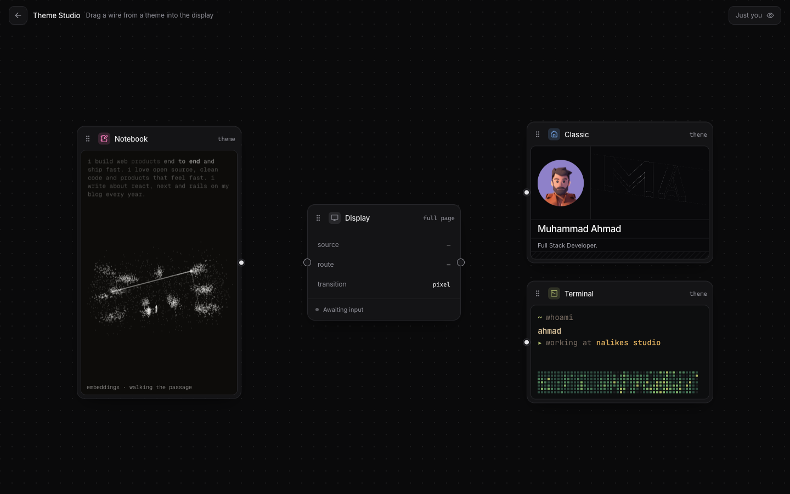
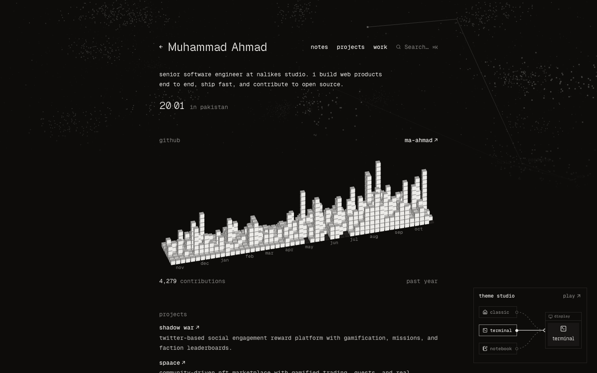

  <picture><source media="(prefers-color-scheme: dark)" srcset="https://shieldcn.dev/header/grid.svg?title=mahmad.me&amp;subtitle=My+personal+portfolio+and+Theme+Studio+playground.&amp;size=wide&amp;mode=dark&amp;theme=zinc&amp;font=geist" /></picture>

  <a href="https://github.com/MA-Ahmad/myPortfolio"><picture><source media="(prefers-color-scheme: dark)" srcset="https://shieldcn.dev/github/MA-Ahmad/myPortfolio/license.svg?variant=outline&amp;mode=dark&amp;font=geist" /></picture></a>
  <a href="https://github.com/MA-Ahmad/myPortfolio"><picture><source media="(prefers-color-scheme: dark)" srcset="https://www.shieldcn.dev/github/stars/MA-Ahmad/myPortfolio.svg?variant=outline&amp;mode=dark&amp;font=geist" /></picture></a>

My personal portfolio, showing my skills, experience, projects and articles. It also has a playground where you can switch between three versions of the site.

→ Live site: [mahmad.me](https://mahmad.me)

<table>
  <tr>
    <td width="50%">
      
       <b>Home page</b> · <a href="https://mahmad.me">mahmad.me</a>
    </td>
    <td width="50%">
      
       <b>Playground</b> · <a href="https://mahmad.me/theme-studio">mahmad.me/theme-studio</a>
    </td>
  </tr>
  <tr>
    <td width="50%">
      
       <b>Notebook theme</b> · <a href="https://mahmad.me/themes/notebook">mahmad.me/themes/notebook</a>
    </td>
    <td width="50%">
      
       <b>Terminal theme</b> · <a href="https://mahmad.me/themes/terminal">mahmad.me/themes/terminal</a>
    </td>
  </tr>
</table>

## Overview

### Stack

- Next.js 16 and React 19
- Tailwind CSS
- Framer Motion
- Prisma with PostgreSQL
- Cloudflare Workers

### Featured

- Light/Dark themes
- Four versions of the site: classic, terminal, notebook and midnight
- **Playground**: [Theme Studio](https://mahmad.me/theme-studio), where you drag a wire from a theme into a display to open it, with live cursors from other visitors
- Blog from local MDX posts and Dev.to articles
- GitHub contribution graph
- Command menu (<kbd>⌘</kbd> <kbd>K</kbd>)
- AI-ready with [/llms.txt](https://llmstxt.org)
- Link preview image for sharing

## License

Everything in this repository is licensed under the [MIT license](LICENSE).

If you fork it, make sure to <ins>remove all my personal information</ins> (profile, projects, blog posts, images and so on), mainly in `data/` and `public/assets/images/`, before publishing your own website.
