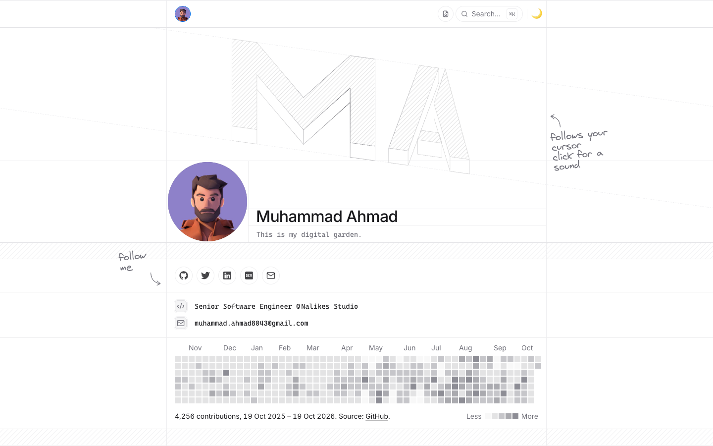
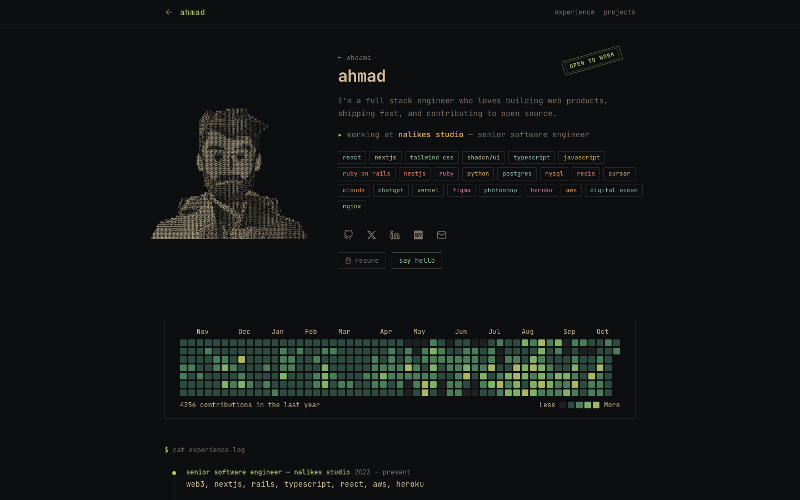

<div align="center">
  <h1><a href="https://mahmad.me" target="_blank">Mahmad.me</a></h1>
  My personal portfolio website to show my skills, experience, projects, and articles I published
</div>

## Screenshots

**Home page** ([mahmad.me](https://mahmad.me))



**Terminal theme** ([mahmad.me/themes/terminal](https://mahmad.me/themes/terminal))



## Built with

- **Framework**: [Next.js 16](https://nextjs.org/) (Pages Router) with [React 19](https://react.dev/)
- **Styling**: [Tailwind CSS](https://tailwindcss.com/)
- **Animations**: [Framer Motion](https://motion.dev/)
- **UI primitives**: [Radix UI](https://www.radix-ui.com/) and [Base UI](https://base-ui.com/) (tooltips), [Headless UI](https://headlessui.com/) (disclosures, popover), [cmdk](https://cmdk.paco.me/) (command menu)
- **Icons**: [Lucide](https://lucide.dev/) and [React Icons](https://react-icons.github.io/react-icons/)
- **Theming**: [next-themes](https://github.com/pacocoursey/next-themes) (light / dark)
- **Blog content**: `.mdx` files parsed with [gray-matter](https://github.com/jonschlinkert/gray-matter) and [remark](https://remark.js.org/), with [Prism](https://prismjs.com/) syntax highlighting
- **ORM**: [Prisma](https://www.prisma.io/) with PostgreSQL
- **Analytics**: [Vercel Analytics](https://vercel.com/analytics), Google Analytics, Microsoft Clarity
- **Deployment**: [Vercel](https://vercel.com)
- **APIs**:
  - [Dev.to](https://developers.forem.com/api) for blog posts
  - [GitHub Contributions API](https://github.com/grubersjoe/github-contributions-api) for the contribution graph

## Pages

- `/` - Profile, overview, GitHub contribution graph, tech stack, experience, education, and projects. Statically generated and revalidated once a day.
- `/blog` - The 10 latest posts, merged from local `.mdx` files in `data/posts` and articles hosted on Dev.to.
- `/blog/[slug]` - A single post. Only the 10 latest posts are served; other slugs return 404.
- `/code-snippets` - Standalone page.
- `/themes/terminal` - The same portfolio as a terminal-style one-page site. `/terminal` redirects here. Open it from the **Themes** group in the command menu.
- `/canvas` - A node canvas with a card for each version of the site. Drag a wire from a card into the display node (or press its Connect button) to open that version full page. Open it from the **Themes** group in the command menu.
- `/themes/notebook` - The same portfolio as a lowercase, monospace notebook index: a 3D GitHub contribution skyline and an animated embedding-space backdrop, both drawn with [three.js](https://threejs.org/). Open it from the **Themes** group in the command menu.
- `/llms.txt`, `/about.md`, `/experience.md`, `/education.md`, `/projects.md` - Plain markdown versions of the profile for AI agents. Requesting `/` with an `Accept: text/markdown` header returns the same content as `/llms.txt`.

Press <kbd>⌘</kbd> <kbd>K</kbd>, <kbd>Ctrl</kbd> <kbd>K</kbd>, or <kbd>/</kbd> on any page to open the command menu.

## Overview

- `components/*` - Page components.
  - `portfolio/*` - Homepage sections (profile header, overview, contribution graph, stack, experience, education, projects).
  - `blog/*` - Blog list and post components.
  - `command-menu/*` - The ⌘K search menu.
  - `shared/*` - Reusable components like the top navbar and footer.
  - `layouts/*` - Page layouts.
  - `theme/*` - Color mode switcher and Prism theme.
  - `ui/*` - Low-level UI primitives.
- `data/*` - Site content.
  - `profile.ts` - Name, avatar, contact details, resume URL, current jobs, and social links.
  - `data.ts` - Experience, education, and tech stack.
  - `projectData.ts` - Projects.
  - `posts/*` - Local MDX blog posts.
  - `constants.ts` - Site URL, GitHub username, and Dev.to API URL.
- `lib/*` - Utilities and data fetching (Dev.to posts, GitHub contributions, markdown for agents).
- `pages/api/*` - [API routes](https://nextjs.org/docs/pages/building-your-application/routing/api-routes).
- `themes/*` - Alternative versions of the portfolio, each served at `/themes/<name>`.
  - `registry.ts` - The list of themes. To add one, create `themes/<name>/` and add it here.
  - `terminal/*` - The terminal theme.
  - `notebook/*` - The notebook theme.
- `prisma/*` - Prisma schema and migrations (PostgreSQL).
- `public/*` - Static assets (audio, fonts, images).
- `styles/globals.css` - Global styles and theme CSS variables.

## Running Locally

Requires Node.js 20.9 or newer and Yarn.

```sh
git clone https://github.com/MA-Ahmad/myPortfolio
cd myPortfolio && yarn install
yarn dev
```

The above commands will start the application on [http://localhost:3000/](http://localhost:3000)

## Environment Variables

Create a `.env` file in the project root:

| Variable | Used for |
| --- | --- |
| `DEVTO_USERNAME` | Dev.to username whose articles are listed on the blog |
| `DATABASE_URL` | PostgreSQL connection string for Prisma (`/api/posts` routes) |
| `IP_ADDRESS_HASH` | Salt used to hash visitor IP addresses in `/api/posts/[id]` |
| `GA_TRACKING_ID` | Google Analytics measurement ID |
| `MICROSOFT_CLARITY` | Microsoft Clarity project ID |

## Production

The site is deployed on Vercel from the `main` branch. To build and run a production server yourself:

```sh
yarn build
yarn start
```

Add the same environment variables to your Vercel project (**Settings → Environment Variables**) before deploying.

## Scripts

| Command | Description |
| --- | --- |
| `yarn dev` | Start the development server |
| `yarn build` | Create a production build |
| `yarn start` | Serve the production build |
| `yarn lint` | Run ESLint |

## Cloning / Forking

Please review the [LICENSE](LICENSE) and remove all of my personal information (profile, projects, blog posts, images, etc.), mainly in `data/` and `public/assets/images/`.
